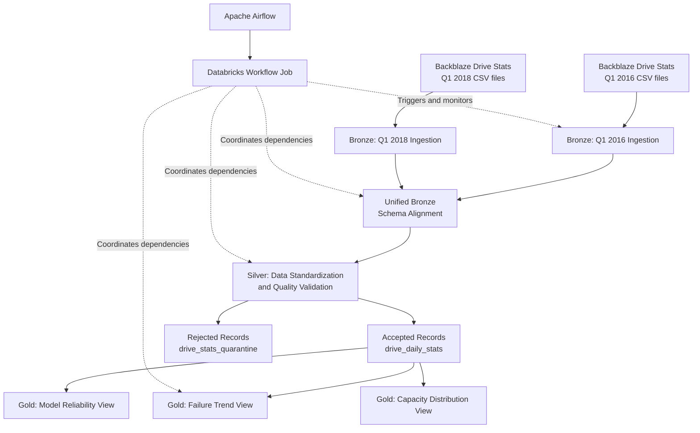
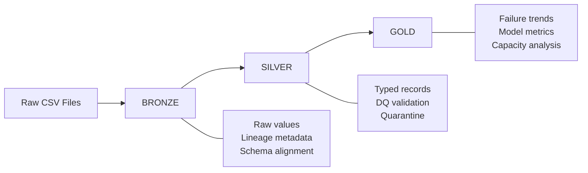
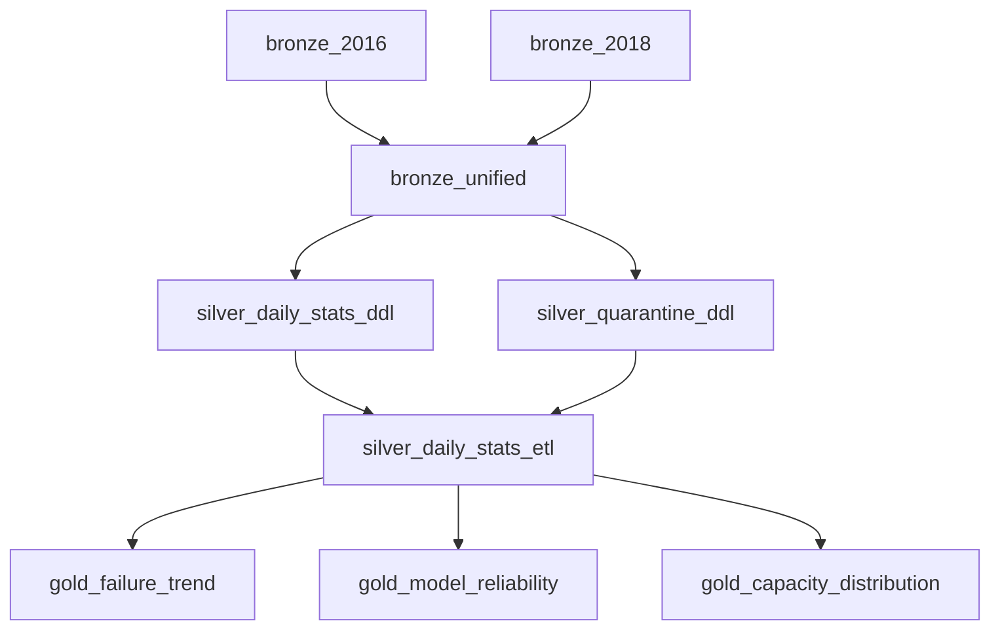

# Backblaze Drive Reliability Pipeline

## 1. Project Overview

The **Backblaze Drive Reliability Pipeline** is an end-to-end Data Engineering project built to process historical hard-drive telemetry data and transform raw daily observations into structured, quality-checked, analytics-ready datasets.

The project uses historical Backblaze Drive Stats datasets from **Q1 2016 and Q1 2018** to demonstrate how a data pipeline can handle large volumes of semi-structured CSV data, schema evolution, data quality validation, quarantine management, analytical transformations, and workflow orchestration.

The pipeline follows a Medallion Architecture:

- **Bronze:** Ingests and preserves raw source observations.
- **Silver:** Standardizes data types, validates business rules, identifies duplicates, and separates invalid records.
- **Gold:** Publishes business-facing analytical views for drive failure trends, model-level reliability, and capacity distribution.

The transformation pipeline is implemented using **Databricks and PySpark**, with Delta tables and Unity Catalog for data organization. Databricks Workflows manages the internal execution dependencies, while Apache Airflow acts as the external orchestrator and triggers the Databricks job.

The project also explores schema evolution by comparing two historical dataset periods with different source schemas.

### Project Objectives

- Build a multi-period data pipeline using real-world historical drive telemetry.
- Understand and implement Medallion Architecture.
- Handle source schema differences across historical datasets.
- Preserve raw source data and ingestion lineage.
- Implement data quality checks and quarantine handling.
- Build analytical views for drive reliability analysis.
- Orchestrate dependent transformations using Databricks Workflows.
- Integrate Apache Airflow with Databricks for external orchestration.
- Apply engineering practices around repeatability, validation, failure handling, and maintainability.

---

## 2. Problem Statement

Backblaze publishes daily hard-drive operational data containing information such as:

- Drive serial number
- Drive model
- Observation date
- Drive capacity
- Failure indicator
- SMART attributes

The data is distributed as daily CSV files. Processing these files directly for analytics introduces several challenges.

### Key Engineering Challenges

**1. Multiple source files**

Historical datasets contain many daily CSV files. Processing them individually for downstream analytics would make data management and validation difficult.

**2. Schema evolution**

The Q1 2016 dataset contains 95 source columns, whereas the Q1 2018 dataset contains 105.

Ten SMART-related columns were introduced in the later dataset. Combining the two periods requires explicit schema alignment.

**3. Data standardization**

Source values need to be converted into appropriate data types. Dates can have different formats, and numeric fields may contain values that cannot be safely converted.

**4. Data quality**

Invalid dates, missing mandatory fields, invalid failure indicators, malformed numeric values, and duplicate observations must be identified before publishing curated data.

**5. Data traceability**

When a record fails validation, the pipeline should preserve enough original information to investigate why it was rejected.

**6. Pipeline orchestration**

The ingestion, consolidation, transformation, and analytical stages must execute in the correct dependency order. A downstream task should not run before its upstream data is ready.

### Solution

The project addresses these challenges through a layered Delta Lake architecture with explicit schema handling, data quality rules, quarantine processing, analytical views, and two levels of orchestration.

---

## 3. Data Sources

The project uses the Backblaze Drive Stats historical datasets for two quarterly periods.

| Dataset               | Period  | Daily CSV files | Source columns |
| --------------------- | ------- | --------------- | -------------- |
| Backblaze Drive Stats | Q1 2016 | 91              | 95             |
| Backblaze Drive Stats | Q1 2018 | 90              | 105            |

### Source Data Characteristics

Each daily CSV contains drive-level observations.

Important source attributes include:

| Column           | Description                                                   |
| ---------------- | ------------------------------------------------------------- |
| `date`           | Date of the drive observation                                 |
| `serial_number`  | Unique identifier of the physical drive                       |
| `model`          | Drive model                                                   |
| `capacity_bytes` | Drive capacity in bytes                                       |
| `failure`        | Failure indicator (0 or 1)                                    |
| `smart_*`        | SMART attributes containing drive health-related measurements |

The SMART attributes provide additional operational information and differ between the two historical periods.

### Source Validation

Before ingestion, the source archives were validated.

The validation work included:

- Checking the number of daily CSV files.
- Validating daily file headers.
- Checking ordered column consistency.
- Comparing the Q1 2016 and Q1 2018 schemas.
- Identifying added and removed columns.

**Schema comparison result:**

- Q1 2016: 95 columns.
- Q1 2018: 105 columns.
- Added columns: 10.
- Removed columns: 0.
- Actual Q1 2018 schema matched its documented schema.

All 90 Q1 2018 daily CSV files passed the ordered-header consistency check.

---

## 4. Architecture

The project follows a Medallion Architecture with Apache Airflow acting as the external orchestrator.

### High-Level Architecture Diagram



### Architecture Components

| Component              | Responsibility                            |
| ---------------------- | ----------------------------------------- |
| Backblaze CSV datasets | Historical source data                    |
| Databricks             | Distributed data processing               |
| PySpark                | Data ingestion and transformation         |
| Delta Lake             | Transactional storage for pipeline tables |
| Unity Catalog          | Data catalog and schema organization      |
| Bronze layer           | Raw source preservation                   |
| Silver layer           | Standardization and quality validation    |
| Quarantine table       | Invalid record investigation              |
| Gold layer             | Business-facing analytical views          |
| Databricks Workflows   | Internal task dependencies and execution  |
| Apache Airflow         | External workflow orchestration           |
| Docker                 | Local Airflow environment                 |

### Medallion Data Flow



---

## 5. Technology Stack

| Technology                  | Usage                                              |
| --------------------------- | -------------------------------------------------- |
| Python                      | Supporting scripts and project utilities           |
| PySpark                     | Distributed data transformations                   |
| Databricks                  | Data Engineering platform                          |
| Delta Lake                  | Storage format for Bronze and Silver tables        |
| Unity Catalog               | Catalog and schema organization                    |
| SQL                         | DDL, validation queries, and Gold analytical views |
| Databricks Workflows        | Internal job orchestration                         |
| Databricks Asset Bundles    | Job configuration and deployment                   |
| Apache Airflow 3.4.0        | External orchestration                             |
| Databricks Airflow Provider | Airflow-to-Databricks integration                  |
| Docker                      | Local Airflow deployment                           |
| Git and GitHub              | Version control and project documentation          |

---

## 6. Implementation Details

### Stage 1: Source Data Profiling and Validation

Before building the Databricks pipeline, the historical source datasets were examined and validated.

The validation process included:

- Inspecting the extracted directory structure.
- Checking daily CSV file counts.
- Profiling daily row counts.
- Validating column counts and ordered headers.
- Comparing historical source schemas.
- Identifying schema changes between periods.

The Q1 2016 archive contained 91 daily CSV files, while Q1 2018 contained 90.

The Q1 2018 schema was verified against its documented column structure, and the ten newly introduced SMART columns were identified.

**Engineering decision:** Source validation was performed before ingestion so that schema inconsistencies could be identified early instead of being discovered during downstream transformations.

### Stage 2: Bronze Layer — Raw Data Ingestion

The Bronze layer ingests the two historical periods independently.

**Source-specific tables:**

- `backblaze_data.ing_bronze.drive_observations_2016_q1`
- `backblaze_data.ing_bronze.drive_observations_2018_q1`

**Unified Bronze table:**

- `backblaze_data.ing_bronze.drive_observations`

#### Ingestion Responsibilities

1. Read all daily CSV files for the relevant period.
2. Preserve source values as strings.
3. Disable automatic schema inference.
4. Validate expected source column counts.
5. Validate mandatory source columns.
6. Add ingestion metadata.
7. Write the source period into a dedicated Delta table.

#### Metadata Columns

| Column              | Purpose                                                    |
| ------------------- | ---------------------------------------------------------- |
| `_source_file_path` | Identifies the source file associated with the observation |
| `_ingested_at`      | Records the ingestion timestamp                            |

#### Bronze Loading Strategy

The period-specific ingestion notebooks use a full snapshot overwrite.

The original source-specific Bronze tables are retained separately and are not modified by the unified consolidation process.

### Stage 3: Unified Bronze — Schema Evolution

One of the important engineering challenges in this project was handling the schema difference between Q1 2016 and Q1 2018.

The earlier dataset contains 95 columns, while the later dataset contains 105.

Instead of relying on an implicit schema merge, the unified Bronze notebook explicitly aligns both datasets to the later schema.

#### Schema Alignment Approach

- The Q1 2018 schema acts as the target schema.
- The ten newly introduced columns are added to the Q1 2016 records as `NULL`.
- Original source values are preserved.
- Source metadata is retained.
- A `_period` column identifies the source period.

The ten additional columns are:

- `smart_177_normalized`
- `smart_177_raw`
- `smart_179_normalized`
- `smart_179_raw`
- `smart_181_normalized`
- `smart_181_raw`
- `smart_182_normalized`
- `smart_182_raw`
- `smart_235_normalized`
- `smart_235_raw`

#### Period-Level Replacement

The unified Bronze table is partitioned by `_period`.

The notebook uses Delta Lake's `replaceWhere` option to replace one period at a time.

This means that refreshing Q1 2016 does not overwrite Q1 2018.

**Why this approach?**

- Prevents unnecessary replacement of unaffected periods.
- Makes historical period refreshes more controlled.
- Preserves the original source-specific Bronze tables.
- Provides a repeatable way to rebuild individual periods.

The notebook also validates row counts, schema alignment, expected NULL values, duplicate observation groups, and period isolation.

### Stage 4: Silver Layer — Data Standardization and Quality Validation

The Silver layer transforms unified Bronze observations into clean, typed records.

**Source:**

`backblaze_data.ing_bronze.drive_observations`

**Curated target:**

`backblaze_data.sot_silver.drive_daily_stats`

**Quarantine target:**

`backblaze_data.sot_silver.drive_stats_quarantine`

#### Transformation Responsibilities

1. Read the unified Bronze table.
2. Preserve the original record payload for investigation.
3. Standardize dates.
4. Convert numeric fields.
5. Validate mandatory fields.
6. Identify duplicate observations.
7. Assign rejection reasons and rule identifiers.
8. Separate accepted and rejected records.
9. Refresh the Silver and quarantine tables.
10. Perform final reconciliation and data quality checks.

#### Data Type Standardization

**Date conversion**

The pipeline supports the following source date formats:

- `yyyy-MM-dd`
- `M/d/yy`

Invalid date values are identified using safe timestamp parsing.

**Capacity conversion**

`capacity_bytes` is converted into BIGINT using safe casting.

The conversion uses an intermediate decimal representation to handle large numeric source values safely.

**Failure conversion**

The failure indicator is converted into an integer and validated against the permitted values of 0 and 1.

**SMART attribute conversion**

SMART normalized columns are identified dynamically using their column names.

Columns ending in `_normalized` are converted to BIGINT.

SMART raw columns remain STRING to preserve their original representations.

### Stage 5: Data Quality Rules

The Silver ETL implements explicit data quality rules.

| Rule ID                           | Validation                   | Rejection condition                                 |
| --------------------------------- | ---------------------------- | --------------------------------------------------- |
| `DQ_001_PERIOD_REQUIRED`          | Period validation            | Missing or empty period                             |
| `DQ_002_DATE_VALID`               | Date validation              | Missing or unparseable date                         |
| `DQ_003_SERIAL_REQUIRED`          | Serial number validation     | Missing or empty serial number                      |
| `DQ_004_FAILURE_FLAG`             | Failure indicator validation | Value is not 0 or 1                                 |
| `DQ_005_CAPACITY_NUMERIC`         | Capacity validation          | Non-null capacity cannot be converted               |
| `DQ_006_SMART_NORMALIZED_NUMERIC` | SMART validation             | Non-null normalized SMART value cannot be converted |
| `DQ_007_UNIQUE_GRAIN`             | Duplicate validation         | Duplicate observation grain                         |

#### Expected Data Grain

The expected grain of the Silver dataset is:

`(_period, date, serial_number)`

This represents one drive observation per source period, observation date, and drive serial number.

Duplicate groups are detected using a PySpark window function partitioned by these three columns.

The pipeline does not silently discard duplicate records. It routes records belonging to duplicate groups to quarantine.

### Stage 6: Quarantine Management

Invalid records are separated from accepted Silver records.

**Quarantine table:**

`backblaze_data.sot_silver.drive_stats_quarantine`

The quarantine table preserves:

| Column              | Purpose                                     |
| ------------------- | ------------------------------------------- |
| `record_payload`    | Original record serialized as JSON          |
| `_period`           | Source period                               |
| `_source_file_path` | Original source file                        |
| `_ingested_at`      | Original ingestion timestamp                |
| `rejection_reason`  | Human-readable rejection details            |
| `rule_name`         | Corresponding data quality rule identifiers |
| `quarantined_at`    | Timestamp when the record was quarantined   |

The original record payload is retained so that rejected records can be investigated without needing to reconstruct their original values from the transformed dataset.

**Quarantine loading strategy:** Full overwrite on each ETL execution to prevent duplicate quarantine entries across reruns.

### Stage 7: Silver Loading Strategy and Reconciliation

The Silver and quarantine tables are refreshed from the current unified Bronze snapshot.

The current implementation uses a full refresh rather than incremental processing.

After loading, the pipeline validates record reconciliation:

`Bronze Source Records = Silver Accepted Records + Quarantined Records`

It also validates:

- Silver record grain uniqueness.
- Mandatory field completeness.
- Valid failure indicator values.
- Final record counts.
- Accepted and rejected record counts by source period.

This provides an explicit validation gate before downstream analytics are published.

### Stage 8: Gold Layer — Analytical Views

The Gold layer contains business-facing SQL views built on top of the Silver dataset.

These views provide different perspectives on drive observations and reported failures.

#### 8.1 Drive Failure Trend View

**View:**

`backblaze_data.sot_gold_views.drive_failure_trend_vw`

**Grain:** One row per date and source period.

Metrics:

- Total drive observations.
- Failed drive observations.
- Daily observed failure percentage.

Calculation:

`Daily Observed Failure Percentage = (Failed Drive Observations / Total Drive Observations) × 100`

This view provides a daily perspective on reported drive failures. This is an observation-based metric, not normalized for drive exposure duration, and should not be treated as a production-grade reliability metric or annualized failure rate (AFR). Drive-day-based AFR calculation using an appropriate exposure methodology is listed in future scope.

#### 8.2 Drive Model Reliability View

**View:**

`backblaze_data.sot_gold_views.drive_model_reliability_vw`

**Grain:** One row per drive model and source period.

Metrics:

- Total drive observations.
- Distinct drives observed.
- Failed drive observations.
- Observed failure percentage.

This view enables comparisons between drive models across the selected historical periods.

**Important metric distinction:** The calculated percentage represents the proportion of observed records with a failure indicator of 1. It is not an annualized failure rate (AFR). The metric does not independently normalize for drive exposure duration.

#### 8.3 Drive Capacity Distribution View

**View:**

`backblaze_data.sot_gold_views.drive_capacity_distribution_vw`

**Grain:** One row per exact drive capacity and source period.

Metrics:

- Capacity in bytes.
- Capacity in decimal terabytes.
- Total drive observations.
- Distinct drives observed.
- Failed drive observations.

Capacity conversion:

`Capacity TB = Capacity Bytes / 1,000,000,000,000`

The view groups by exact capacity values rather than assigning arbitrary capacity bands.

---

## 7. Databricks Workflow Orchestration

The internal pipeline is orchestrated using Databricks Workflows.

**Job name:**

`jb_backblaze_drive_reliability`

The job contains nine tasks.

| Task                         | Responsibility                         | Dependency                  |
| ---------------------------- | -------------------------------------- | --------------------------- |
| `bronze_2016`                | Q1 2016 ingestion                      | None                        |
| `bronze_2018`                | Q1 2018 ingestion                      | None                        |
| `bronze_unified`             | Schema alignment and consolidation     | Both Bronze ingestion tasks |
| `silver_daily_stats_ddl`     | Silver table DDL                       | Unified Bronze              |
| `silver_quarantine_ddl`      | Quarantine table DDL                   | Unified Bronze              |
| `silver_daily_stats_etl`     | Standardization and quality validation | Both Silver DDL tasks       |
| `gold_failure_trend`         | Create failure trend view              | Silver ETL                  |
| `gold_model_reliability`     | Create model reliability view          | Silver ETL                  |
| `gold_capacity_distribution` | Create capacity distribution view      | Silver ETL                  |

### Workflow Dependency Diagram



### Workflow Design Decisions

- Independent source ingestion tasks execute separately.
- Unified Bronze waits for both ingestion tasks.
- Silver DDL tasks execute after Bronze consolidation.
- Silver ETL waits for both DDL tasks.
- Gold analytical tasks execute only after successful Silver processing.
- Maximum concurrent job runs is configured as one.
- Retry settings are configured for the ingestion and transformation tasks.

The workflow is currently configured for manual execution without a recurring schedule.

### Databricks Asset Bundles

The job configuration is maintained as YAML using Databricks Asset Bundles.

The project includes:

- `databricks.yml`
- `resources/jb_backblaze_drive_reliability.job.yml`

This keeps the job definition in version control and makes deployment more manageable than maintaining all job configuration manually in the workspace.

---

## 8. Apache Airflow Integration

Apache Airflow is used as the external orchestrator.

Instead of duplicating the data transformation logic inside Airflow, the DAG triggers the existing Databricks Workflow Job.

This creates a separation between:

- **Airflow:** External workflow orchestration.
- **Databricks Workflows:** Internal data processing and task dependencies.

### Airflow DAG

**DAG ID:**

`backblaze_drive_reliability_pipeline`

**DAG file:**

`airflow/dags/backblaze_drive_reliability_dag.py`

### Operator

The DAG uses:

`DatabricksRunNowOperator`

Important configuration:

| Parameter                | Configuration        |
| ------------------------ | -------------------- |
| `databricks_conn_id`     | `databricks_default` |
| `job_id`                 | `376708906540244`    |
| `wait_for_termination`   | `True`               |
| `polling_period_seconds` | `30`                 |
| `schedule`               | `None`               |
| `catchup`                | `False`              |

### Execution Flow

1. Airflow receives a manual DAG trigger.
2. The DAG executes the Databricks operator.
3. The operator triggers the existing Databricks Job.
4. Databricks executes the nine-task workflow according to its dependencies.
5. Airflow polls the Databricks job status.
6. Airflow waits for the Databricks job to finish.
7. The Airflow task reflects the final Databricks job outcome.

### Why Use Both Airflow and Databricks Workflows?

The two orchestration layers serve different purposes.

Databricks Workflows manages dependencies between Databricks notebooks and transformations.

Airflow provides an external orchestration layer that can coordinate Databricks with other systems and workflows.

This approach avoids maintaining duplicate transformation logic in two orchestration platforms.

### Local Airflow Environment

Airflow is deployed locally using Docker.

The setup uses:

- Apache Airflow 3.4.0.
- LocalExecutor.
- PostgreSQL metadata database.
- Custom Airflow image.
- Databricks provider package.

The Databricks connection is configured through Airflow's connection management, keeping authentication credentials outside the DAG source code.

The local Airflow environment is intended for development and demonstration, not production deployment.

---

## 9. Project Structure

The repository is organized to separate data preparation, Databricks notebooks, job configuration, Airflow orchestration, and documentation.

```
BackblazeDriveReliabilityPipeline/
│
├── notebooks/
│   ├── bronze/
│   ├── silver/
│   │   ├── ddl/
│   │   └── etl/
│   └── gold/
│
├── resources/
│   └── jb_backblaze_drive_reliability.job.yml
│
├── airflow/
│   ├── dags/
│   │   └── backblaze_drive_reliability_dag.py
│   ├── Dockerfile
│   └── docker-compose.yaml
│
├── databricks.yml
├── .gitignore
└── README.md
```

*Note: Local Airflow configuration, environment files, and runtime logs are excluded from version control. Raw datasets are also excluded to avoid committing large source archives.*

---

## 10. Data Quality and Validation Results

Validation is performed at multiple stages rather than relying only on the final output.

| Layer                 | Validation                                                                                         |
| --------------------- | -------------------------------------------------------------------------------------------------- |
| Source                | Daily file counts and source header consistency                                                    |
| Bronze                | Expected column counts and required source columns                                                 |
| Unified Bronze        | Schema alignment, period isolation, expected NULL columns, duplicate grain checks                  |
| Silver                | Data type conversion, mandatory fields, failure values, duplicate grain, quarantine classification |
| Silver reconciliation | Source count equals accepted plus quarantined                                                      |
| Gold                  | Analytical view definitions and aggregation grain                                                  |

### Execution Evidence

The following results were observed during project execution:

| Metric                                         | Observed result |
| ---------------------------------------------- | --------------- |
| Bronze unified records                         | 14,417,380      |
| Silver curated records                         | 14,417,380      |
| Quarantined records after capacity parsing fix | 0               |
| Q1 2016 daily source files                     | 91              |
| Q1 2018 daily source files                     | 90              |
| Q1 2016 source columns                         | 95              |
| Q1 2018 source columns                         | 105             |
| Added source columns                           | 10              |
| Removed source columns                         | 0               |

The Silver output reconciled with the Bronze source during the validated execution.

The zero quarantine count reflects the final validated dataset after resolving the capacity parsing issue. It should not be interpreted as evidence that the quarantine mechanism is unnecessary; the pipeline retains the validation and rejection logic for future source anomalies.

---

## 11. Key Engineering Decisions

This project involved several design choices that are important beyond simply implementing transformations.

| Design decision                                          | Reason                                                                     |
| -------------------------------------------------------- | -------------------------------------------------------------------------- |
| Preserve Bronze values as strings                        | Avoid unintended type conversion and retain source representations         |
| Keep period-specific Bronze tables                       | Maintain source-period traceability                                        |
| Explicit schema alignment                                | Handle historical schema differences deterministically                     |
| Add `_period`                                            | Distinguish observations from different source periods                     |
| Partition unified Bronze by `_period`                    | Support controlled period-level replacement                                |
| Use `replaceWhere`                                       | Refresh one historical period without replacing another                    |
| Use safe type conversions                                | Prevent malformed source values from failing the entire transformation     |
| Dynamically identify SMART normalized columns            | Avoid hardcoding every SMART normalized attribute into the conversion loop |
| Preserve raw record payloads                             | Support investigation of rejected records                                  |
| Quarantine duplicates rather than silently dropping them | Preserve rejected data for traceability                                    |
| Reconcile accepted and rejected records                  | Detect missing or unexpectedly duplicated records during loading           |
| Use full refresh for Silver                              | Keep the current curated output reproducible from the Bronze snapshot      |
| Separate Airflow and Databricks orchestration            | Avoid duplicating transformation logic                                     |

---

## 12. Future Scope and Enhancements

The current project establishes a working batch pipeline. The following enhancements are potential next steps and are **not part of the current implemented scope**.

### 13.1 Incremental Processing

The current Silver implementation performs a full refresh.

A future enhancement would be to introduce incremental processing using Delta Lake capabilities.

Potential improvements:

- Process only newly arrived source files.
- Track previously processed periods or files.
- Implement incremental `MERGE` operations where appropriate.
- Avoid reprocessing the entire historical dataset.
- Maintain a reliable ingestion watermark or high-water mark.
- Introduce backfill resumability so interrupted historical processing can resume from a controlled checkpoint.

### 13.2 Automated Schema Registry

The current implementation uses explicit source schema validation and a defined list of ten newly introduced columns.

A future enhancement would be to introduce a schema registry.

Potential capabilities:

- Store approved source schema versions.
- Compare incoming schemas with registered schemas.
- Detect added, removed, and changed columns automatically.
- Classify compatible and breaking schema changes.
- Trigger notifications or quarantine ingestion when an unexpected schema is detected.

### 13.3 Advanced Data Quality Monitoring

The existing pipeline uses explicit data quality rules and quarantine handling.

Future improvements could include:

- Configurable quality thresholds.
- Quality metrics by source period.
- Historical data quality trends.
- Automated alerts for unexpected rejection rates.
- Monitoring null percentages and distribution changes.
- Data quality dashboards.

### 13.4 Improved Quarantine Reprocessing

A future enhancement would introduce a controlled mechanism for reprocessing records after correcting their source data or transformation rules.

Potential capabilities:

- Reprocess selected quarantined records.
- Track original and corrected record versions.
- Record the reason for reprocessing.
- Maintain audit information for rejected and recovered records.

### 13.5 Production Monitoring and Alerting

The current implementation focuses on workflow execution and final validation.

Potential production enhancements include:

- Airflow failure notifications.
- Databricks job execution alerts.
- Pipeline duration monitoring.
- Data freshness monitoring.
- Centralized execution logging.
- Automated reporting of row-count differences.

### 13.6 Analytical Enhancements

The current Gold views provide observation-based failure metrics.

Further analytical work could include:

- Drive model comparisons across longer historical periods.
- Time-based failure trend analysis.
- Capacity-band analysis.
- SMART attribute trend analysis.
- Drive survival analysis.
- Exposure-duration-aware reliability metrics.
- Annualized failure rate calculations using an appropriate exposure methodology.

These enhancements would need additional metric definitions and validation before being treated as reliable business measures.

### 13.7 Cloud Deployment and Infrastructure Automation

The current Airflow environment is locally deployed using Docker.

Possible future improvements:

- Deploy Airflow to a managed or cloud-hosted environment.
- Use a cloud secret manager for credentials.
- Introduce environment-specific Databricks configurations.
- Automate deployment through CI/CD.
- Add automated testing for notebooks and transformation logic.
- Introduce infrastructure-as-code for repeatable environment provisioning.

---

## 13. Limitations and Current Scope

The project is a historical batch-processing pipeline and has several intentional scope boundaries.

- Only Q1 2016 and Q1 2018 source periods are included.
- Silver currently uses full refresh rather than incremental processing.
- The pipeline does not implement a high-water mark or backfill resumability; these capabilities are listed as future scope.
- The quarantine mechanism is implemented, but the final validated execution produced zero quarantined records.
- Gold metrics are observation-based and are not equivalent to annualized failure rates.
- The current Airflow deployment is local and intended for development and demonstration.
- The Airflow DAG is manually triggered; recurring scheduling has not been configured.
- Automated schema registry, production alerting, and CI/CD are future enhancements.

These boundaries help distinguish the current implementation from possible production extensions.

---

## 14. How to Run the Project

### Prerequisites

- Access to a Databricks workspace.
- Databricks compute with PySpark and Delta Lake support.
- Unity Catalog enabled.
- Backblaze Q1 2016 and Q1 2018 source datasets.
- Databricks CLI for Asset Bundle deployment.
- Docker Desktop for local Airflow execution.
- Git.

### Step 1: Prepare the Source Data

Download the relevant Backblaze historical datasets and extract the daily CSV files.

Upload the extracted files into the corresponding Unity Catalog Volume locations:

```
/Volumes/backblaze_data/ing_bronze/source_files/extracted/2016_Q1/

/Volumes/backblaze_data/ing_bronze/source_files/extracted/2018_Q1/
```

### Step 2: Deploy the Databricks Job

From the repository root, configure the appropriate Databricks CLI authentication and validate the bundle.

```
databricks bundle validate -t dev
```

Deploy the bundle:

```
databricks bundle deploy -t dev
```

The job definition is maintained in:

```
resources/jb_backblaze_drive_reliability.job.yml
```

### Step 3: Execute the Databricks Workflow

Run the deployed job from the Databricks Workflows interface.

The workflow executes:

1. Q1 2016 Bronze ingestion.
2. Q1 2018 Bronze ingestion.
3. Unified Bronze consolidation.
4. Silver DDL tasks.
5. Silver ETL and quarantine processing.
6. Three Gold view creation tasks.

### Step 4: Configure Airflow

Navigate to the Airflow directory:

```
cd airflow
```

Build and start the local Airflow environment:

```
docker compose build
docker compose up -d
```

Check the running services:

```
docker compose ps
```

Open the Airflow interface:

```
http://localhost:8080
```

Configure the Databricks connection in Airflow:

- Connection ID: `databricks_default`
- Connection type: Databricks
- Host: Your Databricks workspace URL
- Password: Your Databricks personal access token

Credentials should be configured locally and must never be committed to Git.

### Step 5: Trigger the Airflow DAG

Find the DAG:

```
backblaze_drive_reliability_pipeline
```

Trigger it manually from the Airflow interface.

Airflow invokes the existing Databricks Job and waits for its completion.

### Step 6: Stop the Local Environment

When finished:

```
docker compose down
```

This stops the containers while preserving the named PostgreSQL volume unless it is explicitly removed.

---

## 15. Interview Discussion Points

This project can be used to discuss the following Data Engineering topics:

1. Why did you choose Medallion Architecture?
2. How did you handle schema evolution between Q1 2016 and Q1 2018?
3. Why did you preserve source values as strings in Bronze?
4. Why did you use `replaceWhere` in the unified Bronze table?
5. What is the difference between full refresh and incremental processing?
6. How did you define the expected grain of the Silver dataset?
7. How did you detect duplicates using PySpark window functions?
8. How did you design the quarantine table?
9. How did you validate source-to-target record reconciliation?
10. Why did you use safe casting instead of direct casting?
11. Why are SMART normalized attributes converted dynamically?
12. What is the difference between Databricks Workflows and Apache Airflow?
13. Why does Airflow trigger an existing Databricks job instead of executing all transformations itself?
14. What happens if an upstream Databricks task fails?
15. How would you extend the pipeline to support incremental processing?
16. How would you implement an automated schema registry?
17. Why is observed failure percentage different from annualized failure rate?

---

## 16. Project Status

| Component                                  | Status                                |
| ------------------------------------------ | ------------------------------------- |
| Historical source data profiling           | Completed                             |
| Q1 2016 source validation                  | Completed                             |
| Q1 2018 source validation                  | Completed                             |
| Schema comparison and drift identification | Completed                             |
| Bronze period-specific ingestion           | Implemented                           |
| Unified Bronze schema alignment            | Implemented                           |
| Period-level Delta replacement             | Implemented                           |
| Silver transformations                     | Implemented                           |
| Data quality rules                         | Implemented                           |
| Quarantine handling                        | Implemented                           |
| Source-to-target reconciliation            | Implemented                           |
| Gold analytical views                      | Implemented                           |
| Databricks Workflows                       | Implemented                           |
| Databricks Asset Bundle configuration      | Implemented                           |
| Airflow integration                        | Implemented and successfully executed |
| Local Docker-based Airflow environment     | Configured                            |
| Incremental Silver processing              | Future scope                          |
| Automated schema registry                  | Future scope                          |
| Production monitoring and alerting         | Future scope                          |
| CI/CD automation                           | Future scope                          |

---

## 17. Conclusion

The Backblaze Drive Reliability Pipeline demonstrates an end-to-end Data Engineering workflow built around historical operational data.

The project goes beyond basic CSV ingestion and SQL transformations by addressing practical engineering concerns such as schema evolution, source preservation, data lineage, data quality validation, quarantine management, repeatable loading strategies, analytical modeling, and multi-level orchestration.

A key design decision was to keep the responsibilities of the different layers clearly separated:

- Bronze preserves and consolidates source observations.
- Silver standardizes records and enforces data quality.
- Gold publishes reusable analytical datasets.
- Databricks Workflows manages internal processing dependencies.
- Apache Airflow coordinates the Databricks job externally.

The implementation also provides a foundation for future enhancements such as incremental processing, automated schema management, advanced monitoring, and production deployment.
